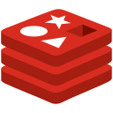

### `$ cat ./about.md`

Разрабатываю бэкенд-сервисы, микросервисную архитектуру, веб-приложения и локальные RAG-системы. Люблю разбираться, как устроено под капотом, автоматизировать рутину через CLI и настраивать рабочее окружение под себя.

- **Среда и инструменты:** `Zed` · `OpenCode` · `Git` · `Docker`
- **Фокус:** микросервисы, архитектура API, интеграция LLM, поиск по документам (RAG) и современные веб-интерфейсы

---

### `$ ls ./featured-projects`

| Проект | Описание | Стек |
| :--- | :--- | :--- |
| **[HabitForge](https://github.com/HabitForge)** | Микросервисная платформа отслеживания привычек с распределёнными семафорами и событиями | `C#` `.NET 8` `Redis` `MassTransit` |
| **[JustAsk](https://github.com/JustAsk)** | Локальный ИИ-наставник по учебному курсу с гибридным поиском и цитированием источников (LTI 1.1 / Moodle) | `Python` `FastAPI` `Ollama` `ChromaDB` |
| **[LunaTracker](https://github.com/LunaTracker)** | Приложение для трекинга цикла с аналитикой фаз и ИИ-рекомендациями | `TypeScript` `React 18` `Vite` `Tailwind` |
| **[conundrum_react](https://github.com)** | Интерактивное веб-приложение на React | `JavaScript` `React` |
| **[neomarket](https://github.com/neomarket)** | Микросервисный маркетплейс на Python | `Python` `FastAPI` `Microservices` |
| **[1c-code-console](https://github.com)** | Двухрежимная консоль кода 1С/BSL | `Bash` `1C` `BSL` |

---

### `$ echo $TECH_STACK`

  
  
  
  
  
  
  
  
  
  
  
  

  

