<div align="center"></div>

### `$ cat ./about.md`

Разрабатываю бэкенд-сервисы, микросервисную архитектуру, веб-приложения и локальные RAG-системы. Люблю разбираться, как устроено под капотом, автоматизировать рутину через CLI и настраивать рабочее окружение под себя.

- **Среда и инструменты:** `Zed` · `OpenCode` · `Git` · `Docker`
- **Фокус:** микросервисы, архитектура API, интеграция LLM, поиск по документам (RAG) и современные веб-интерфейсы

---

### `$ ls ./featured-projects`

| Проект | Описание | Стек |
| :--- | :--- | :--- |
| **[HabitForge](https://github.com/kopityle/HabitForge)** | Микросервисная платформа отслеживания привычек с распределёнными семафорами и событиями | `C#` `.NET 8` `Redis` `MassTransit` |
| **[JustAsk](https://github.com/kopityle/JustAsk)** | Локальный ИИ-наставник по учебному курсу с гибридным поиском и цитированием источников (LTI 1.1 / Moodle) | `Python` `FastAPI` `Ollama` `ChromaDB` |
| **[LunaTracker](https://github.com/kopityle/LunaTracker)** | Приложение для трекинга цикла с аналитикой фаз и ИИ-рекомендациями | `TypeScript` `React 18` `Vite` `Tailwind` |
| **[conundrum_react](https://github.com/progrjava/conundrum_react)** | Интерактивное веб-приложение на React | `JavaScript` `React` |
| **[neomarket](https://github.com/kopityle/neomarket)** | Микросервисный маркетплейс на Python | `Python` `FastAPI` `Microservices` |
| **[1c-pharmacy-accounting](https://github.com/kopityle/1c-pharmacy-accounting)** | Система учёта в аптеке на 1С:Предприятие 8.3 с подбором аналогов, контролем рецептов и анализом продаж | `1C` `BSL` |
| **[1c-code-console](https://github.com/kopityle/1c-code-console)** | Двухрежимная консоль кода 1С/BSL | `Bash` `1C` `BSL` |

---

### `$ echo $TECH_STACK`

<p>
  
  
  
  
  
  
  
  
  
  
  
  
  
</p>

<details>
<summary><b>$ cat ./full-stack.json</b></summary>

```json
{
  "languages": ["C#", ".NET 8", "Python", "TypeScript", "JavaScript", "SQL", "1C (BSL)"],
  "frameworks": ["ASP.NET Core", "FastAPI", "Flask", "React 18", "MassTransit"],
  "ai_rag": ["Ollama", "ChromaDB", "Hybrid Search", "PyMuPDF"],
  "databases": ["PostgreSQL", "Redis", "SQLite"],
  "tools": ["Docker", "Git", "GitHub Actions", "Zed", "OpenCode"]
}
```

</details>

<p align="center">
  
</p>

